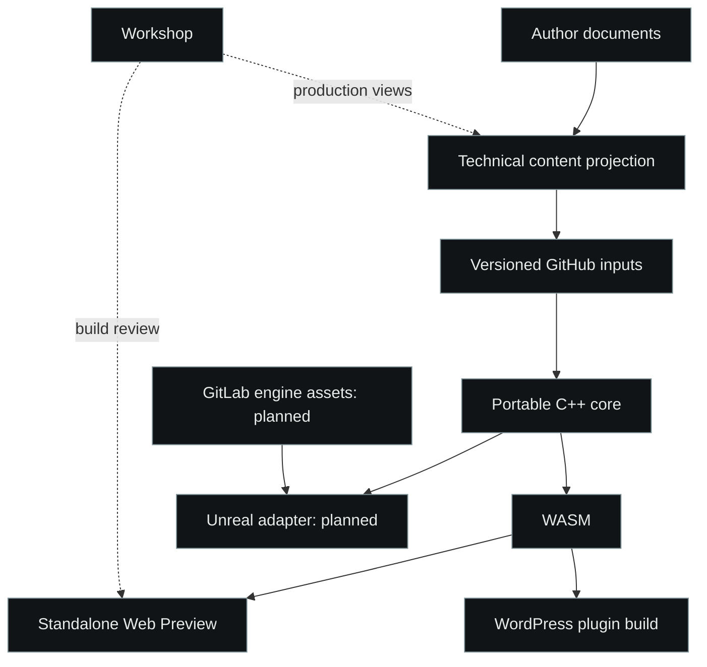

# InterDead: one core, several projections

This is a literary reconstruction of the [InterDead](https://github.com/Zhovten-Games/InterDead)
architecture, not a copy of its game code or story. The domain core is executable
C++ in the product; the literary core remains in author-owned documents.
Technical scene cards and localization keys bridge the two through reviewed,
attributed snapshots. Import is a governed step, not an assumed live Docs deploy.

| Source area | Pseudocode responsibility |
| --- | --- |
| `core/` | [One session](core/session.xml), state, time, knowledge, stress |
| `formats/`, `content/` | [Import](formats/content-import.xml), [authoring](content/authoring.xml), localization provenance |
| `storage/` | [Versioned saves](storage/save-store.xml) through host I/O |
| `bindings/wasm/` | [WASM adapter](bindings/wasm/adapter.xml) |
| Future Unreal | [Planned contract](bindings/unreal/adapter.xml); no working adapter claimed |
| `apps/shared/`, `apps/console/` | [Command translation](apps/shared/commands.xml), [console](apps/console/host.xml) |
| `apps/warden/`, `apps/headless/` | [Real-core verification](apps/warden/scenarios.xml), [replay](apps/headless/replay.xml) |
| `apps/workshop/` | [Production workspace](apps/workshop/README.md) |
| `web/`, `integrations/` | [Browser](web/presentation.xml), [WordPress](integrations/wordpress/plugin.xml) |
| `tools/` | [Build formats and delivery routes](tools/delivery.xml) |
| `schemas/`, `manifest/` | [Boundaries](schemas/contracts.xml), [artifact classes](manifest/artifacts.xml) |
| `governance/`, `tests/` | [Inheritance](governance/inheritance.xml), [acceptance](tests/acceptance.xml) |
| `docs/` | This explanation and the traceability map |
| `external/`, `vendor/` | Pinned attributed inputs, never independently edited derivatives |
| Root build files, `.github/` | Product-specific orchestration; no copied workflow or credentials |

This mirrors responsibility and naming, rather than every private path. Engine
assets, authored dialogue, actual source locators and deployment configuration
are deliberately absent. Implementers can follow the decisions in their own stack.

Warden calls the actual session; it does not assert values against a mock engine.
For bounded work, select complete scenario groups, report their inventory and
remaining gates, and keep a full integration check before publication. The real
InterDead CLI already selects an individual `.warden` scenario; its Make targets
also separate attention, save, narrative and projection checks. This example
recommends grouping those boundaries without compressing away old evidence.
